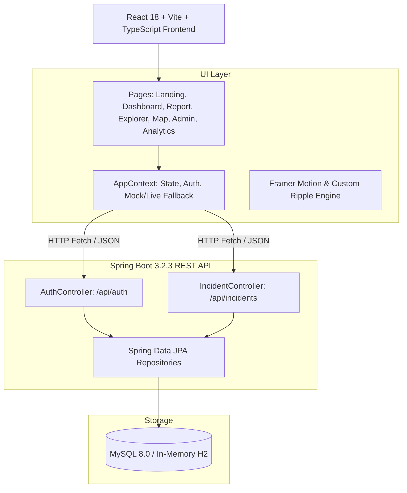

# 🌊 CampusRipple

<div align="center">


**A high-impact campus incident management & ripple impact propagation platform.**  
Designed with an editorial aesthetic, real-time telemetry, and automated dependency-aware incident tracking.

[](https://react.dev/)
[](https://www.typescriptlang.org/)
[](https://vitejs.dev/)
[](https://tailwindcss.com/)
[](https://spring.io/projects/spring-boot)
[](https://www.oracle.com/java/)
[](https://www.mysql.com/)

[Explore Live](#-features) • [Quick Start](#-quick-start) • [Architecture](#-system-architecture) • [API Documentation](#-api-reference)

</div>

---

## 📖 Overview

**CampusRipple** changes the paradigm of traditional campus grievance portals. Instead of treating complaints as isolated tickets, CampusRipple recognizes that campus infrastructure is deeply interconnected — **one broken router disrupts three classes, one power surge halts multiple labs.**

The core visual and functional mantra is:  
> **"One Report. Wider Impact."**

When an incident is reported, the ripple engine automatically evaluates downstream dependencies, detects related and duplicate issues, quantifies affected student counts, and notifies administrators and technicians with prioritized impact metrics.

---

## 🎨 Editorial Design System

CampusRipple pairs digital magazine aesthetics (inspired by high-end editorial layouts like *Vogue* and *Kinfolk*) with technical observability dashboards:

- **Typography**: Editorial serifs paired with clean geometric sans (`Plus Jakarta Sans`) and code telemetry metrics (`JetBrains Mono`).
- **Color Palette**:
  - `Dark Alabaster` (`#0B0F19` / `#0F1115`): Deep obsidian editorial canvas
  - `Editorial Card` (`#161920`): High-contrast matte card backgrounds
  - `Crimson Ripple` (`#D9383A`): Signature incident focus accent
  - `Warm Amber` (`#F59E0B`): Active investigation status
  - `Emerald Resolved` (`#10B981`): Verified resolution state
  - `Royal Slate` (`#3B82F6`): Infrastructure telemetry & routing
- **Visual Micro-Interactions**: Custom magnetic cursor, context-aware trailing cursor tags (`EXPLORE`, `IMPACT`, `TRACE`, `VIEW`), full-page liquid ripple transitions, and progressive scroll storytelling.

---

## ✨ Features

### 1. 📋 Multi-Step Incident Reporting Wizard (`/report`)
- **Step 1 — What happened?**: Categorization (Network, Hardware, Utility, Facility), severity indicator, detailed description.
- **Step 2 — Where did it happen?**: Building picker (`Block A`, `Block B`, `Hostel B`, `Library`), room/wing selector.
- **Step 3 — What is affected?**: Resource toggle matrix (Wi-Fi, Power, Air Conditioning, Projector, Lab Workstations).
- **Step 4 — Review & Broadcast**: Real-time simulated ripple engine that evaluates impacted classrooms and sends automated alerts.

### 2. 📊 Student & Faculty Dashboard (`/dashboard`)
- Dynamic greeting and live campus status badge.
- Telemetry summary cards: Active Incidents, Personal Reports, Total Impacted Students, and Resolved Today.
- Incident feed with severity badges and impact percentage bars.

### 3. 🔍 Incident Explorer (`/explorer`)
- Comprehensive multi-filter engine:
  - Search query by title, room, or incident ID (`INC-2026-XXX`)
  - Filter by Category, Building, Status, and Severity.
- Quick navigation to individual impact deep-dives.

### 4. 🔬 Incident Details & Propagation Analysis (`/incident/:id`)
- **Impact Analysis**: Calculated impact scores, affected headcounts, and location radius.
- **Impact Mode**: Focus toggle that illuminates propagation paths while dimming unaffected campus nodes.
- **Related Reports**: Linked duplicate or dependent incidents with an administrative merge action.
- **Resolution Timeline**: Chronological trail from initial submission to investigation, technician dispatch, and resolution sign-off.

### 5. 🗺️ Interactive Campus Dependency Map (`/map`)
- Visual node graph plotting academic blocks, computer labs, server routers, hostels, and seminar halls.
- Category filters (`All`, `Building`, `Lab`, `Library`, `Hostel`, `Router`).
- Interactive node drawer with active issues and location statistics.

### 6. 🛠️ Admin Operations Center (`/admin`)
- Administrative mission control for technicians and campus facilities staff.
- Technician assignment workflow.
- Lifecycle status progression: `Reported` ➔ `Investigating` ➔ `Assigned` ➔ `In Progress` ➔ `Resolved` ➔ `Verified`.
- Severity escalation and technical resolution summary logging.

### 7. 📈 Telemetry & Analytics (`/analytics`)
- Incident category breakdown and distribution.
- Campus hotspot heatmap identifying recurrent failure points.
- Key efficiency metrics: Average Resolution Time and Resolution Rate (%).

### 8. 🔔 Real-Time Notifications (`/notifications`)
- Activity feed for incident state updates, technician assignments, and emergency campus alerts.
- Unread notification badges and one-click "Mark all as read".

### 9. 🔐 Authentication & User Roles
- Role-based authentication modal supporting **Student** and **Admin / Staff** accounts.
- Persistent local session with Spring Boot backend registration and login endpoints.

---

## 🏗️ System Architecture



---

## 💻 Tech Stack

### Frontend
- **Framework**: [React 18](https://react.dev/) with [TypeScript](https://www.typescriptlang.org/)
- **Bundler & Tooling**: [Vite 6](https://vitejs.dev/)
- **Styling**: [Tailwind CSS 3](https://tailwindcss.com/) with custom typography & palettes
- **Animations**: [Framer Motion](https://www.framer.com/motion/)
- **Icons**: [Lucide React](https://lucide.dev/)

### Backend
- **Framework**: [Spring Boot 3.2.3](https://spring.io/projects/spring-boot)
- **Language**: Java 17
- **Database ORM**: Spring Data JPA / Hibernate
- **Database Support**: MySQL 8.0 (configured) with fallback to H2 runtime
- **Utilities**: Project Lombok

---

## 📂 Project Structure

```text
CampusRipple/
├── backend/                                # Spring Boot Java Backend
│   ├── src/main/java/com/campusripple/
│   │   ├── CampusRippleApplication.java   # Spring Boot Main Entry Point
│   │   ├── controller/
│   │   │   ├── AuthController.java        # User registration & login endpoints
│   │   │   └── IncidentController.java    # Incident CRUD & status endpoints
│   │   ├── model/                         # JPA Entities (Incident, User, Enums)
│   │   └── repository/                    # Spring Data JPA Repositories
│   ├── src/main/resources/
│   │   └── application.properties         # Database and server configuration (Port 8080)
│   ├── pom.xml                            # Maven dependencies & build config
│   └── mvnw / mvnw.cmd                    # Maven wrapper scripts
├── src/                                   # React Frontend
│   ├── components/                        # Navigation, Footer, Modals, Shared Cards
│   ├── context/                           # AppContext (global state, auth, live sync)
│   ├── data/                              # Seed data, campus nodes, mock incidents
│   ├── pages/                             # 10 Application Route Views
│   │   ├── AdminDashboardPage.tsx
│   │   ├── AnalyticsPage.tsx
│   │   ├── CampusMapPage.tsx
│   │   ├── DashboardPage.tsx
│   │   ├── ExplorerPage.tsx
│   │   ├── IncidentDetailPage.tsx
│   │   ├── LandingPage.tsx
│   │   ├── NotificationsPage.tsx
│   │   ├── ProfilePage.tsx
│   │   └── ReportPage.tsx
│   ├── styles/                            # Design tokens & typography definitions
│   ├── types/                             # TypeScript interfaces & domain types
│   ├── App.tsx                            # Primary root routing & layout
│   └── main.tsx                           # React DOM mount point
├── package.json                           # Frontend scripts & npm packages
├── tailwind.config.js                     # Editorial theme colors, fonts, and shadows
├── tsconfig.json                          # TypeScript configuration
└── vite.config.ts                         # Vite configuration
```

---

## 🚀 Quick Start

### Prerequisites
Make sure you have the following installed on your machine:
- **Node.js** (v18.0.0 or higher) & **npm**
- **Java Development Kit (JDK 17)**
- **Maven** (or use the included `./mvnw` wrapper)
- *(Optional)* **MySQL Server** (defaults to `localhost:3306` with database `campuscare_db`)

---

### 1. Setting Up the Frontend

Clone the repository and install npm dependencies:

```bash
# Clone the repository
git clone https://github.com/pravin122386/CampusRipple.git

# Navigate to project directory
cd CampusRipple

# Install frontend dependencies
npm install

# Start the Vite development server
npm run dev
```

The frontend will run at **`http://localhost:3000`** (or `http://localhost:5173`).

---

### 2. Setting Up the Backend (Spring Boot)

Open a second terminal window and navigate to the `backend` directory:

```bash
cd backend

# Build and run with Maven Wrapper (Windows)
.\mvnw.cmd spring-boot:run

# Or on macOS / Linux:
# ./mvnw spring-boot:run
```

The Spring Boot backend will start on **`http://localhost:8080`**.

> **Note on Database**: By default, `backend/src/main/resources/application.properties` connects to MySQL at `localhost:3306/campuscare_db` (`user: root`, `password: password123`). If you do not have MySQL running, the application can also run with H2 database or the frontend can operate in standalone mock mode seamlessly.

---

## 📡 API Reference

### Authentication Endpoints (`/api/auth`)

| Method | Endpoint | Description | Sample Payload |
|---|---|---|---|
| `POST` | `/api/auth/register` | Register a new user | `{"name": "Pravin", "email": "pravin@campus.edu", "password": "secret", "role": "STUDENT"}` |
| `POST` | `/api/auth/login` | Authenticate an existing user | `{"email": "pravin@campus.edu", "password": "secret"}` |

### Incident Endpoints (`/api/incidents`)

| Method | Endpoint | Description |
|---|---|---|
| `GET` | `/api/incidents` | Fetch all incidents ordered by most recent |
| `POST` | `/api/incidents` | Submit a new incident report with ripple telemetry |
| `PUT` | `/api/incidents/{id}/status?status={STATUS}` | Update incident workflow status (`INVESTIGATING`, `IN_PROGRESS`, `RESOLVED`, etc.) |

---

## 🛡️ License

This project was built for educational and demonstration purposes.  
Distributed under the **MIT License**. See `LICENSE` for more information.

---

<div align="center">
  <sub>Engineered by <b>Pravin D.</b> • CampusRipple — One Report. Wider Impact.</sub>
</div>
